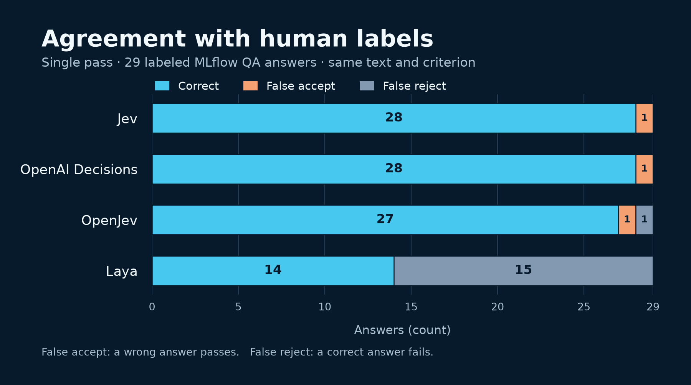

When an evaluator only needs to decide whether an answer is correct, generating a paragraph for every judgment can be expensive. A decision model returns a typed answer and a probability instead. That makes [TypeSafe's Jev](https://docs.typesafe.ai/models), [OpenAI Decisions](https://developers.openai.com/api/docs/guides/decisions), and open-weight models such as [OpenJev](https://github.com/razorback16/openjev) and [Laya](https://github.com/NandhaKishorM/laya) interesting choices for a high-volume judge.

They do not share one API or one definition of confidence. This post compares their contracts, shows how to run the same Boolean check through MLflow, and looks at what our MLflow QA benchmarks actually tell us. The benchmark question is deliberately narrow: **does a candidate technical answer contain a material factual or API error?**

## Two APIs, four models

The native request shapes differ in ways that matter when you move a judge between providers.

|                      | TypeSafe System One                                     | OpenAI Decisions                                            |
| -------------------- | ------------------------------------------------------- | ----------------------------------------------------------- |
| Input                | `state`: text or structured data for the decision       | `input`: text or a message sequence                         |
| Questions            | A named `questions` object                              | A `questions` array                                         |
| Yes/no question      | `noul`, which returns a probability of yes              | `predicate`, which returns a probability of true            |
| Other question types | `choice` and `score`                                    | `choice` and `score`                                        |
| Response             | Typed answers and probabilities; no generated rationale | Typed answers and probabilities, or a refusal; no rationale |

Jev uses TypeSafe's hosted System One API. OpenAI's public-beta Decisions API currently offers `gpt-6-luna`. The [OpenJev project](https://github.com/razorback16/openjev#models) serves its own `openjev-0.1` model and the `laya-1.0` typed-decisions checkpoint through a System One-compatible endpoint. You can self-host them or use the project's hosted endpoint. [Laya's standalone server](https://github.com/NandhaKishorM/laya#self-hosting-http-server-jev-compatible) uses the model name `typed-decisions` instead of `laya-1.0` and has different choice and score limits. These are protocol-compatible routes, **not dedicated OpenJev or Laya integrations in MLflow**.

| Model                | Model and deployment                                                | MLflow judge route                                            |
| -------------------- | ------------------------------------------------------------------- | ------------------------------------------------------------- |
| Jev 1.13.0           | TypeSafe-hosted model                                               | `typesafe:/jev-1.13.0`                                        |
| OpenAI Decisions     | OpenAI-hosted `gpt-6-luna`                                          | `openai:/gpt-6-luna` with `model_api=ModelAPI.DECISIONS`      |
| OpenJev 0.1          | Open weights, 26B total/4B active; local or hosted; text and images | `typesafe:/openjev-0.1` with the endpoint URL and credentials |
| Laya typed-decisions | Open weights, 421M parameters; local or hosted; text only           | `typesafe:/laya-1.0` through OpenJev's compatible endpoint    |

OpenJev and Laya are **not listed in [OpenRouter's Decisions catalog](https://openrouter.ai/api/v1/models?output_modalities=decisions)** as of October 14, 2026. The example below uses [Codiv's System One-compatible endpoint](https://github.com/razorback16/openjev) for them; it does not route those models through OpenRouter.

These APIs accept more than a Boolean question. MLflow's [`make_judge()`](https://mlflow.org/docs/latest/genai/eval-monitor/scorers/llm-judge/custom-judges/) currently exposes Boolean and finite categorical assessments on the decision routes, one question per judge. It does not expose native score questions or a text rationale. A Boolean result uses a 0.5 probability threshold. A probability of 0.8 from one model should not be assumed to mean the same thing as 0.8 from another: [Laya's confidence calculation differs from Jev's](https://github.com/razorback16/openjev#how-the-other-models-differ).

## Run the same MLflow check

Use Python 3.10 or newer, [MLflow 3.17.1](https://github.com/mlflow/mlflow/releases/tag/v3.17.1) or newer, and an OpenAI SDK with the Decisions resource:

```bash
pip install "mlflow>=3.17.1" "openai>=3.26.0"
export TYPESAFE_API_KEY="your-typesafe-key"
export OPENAI_API_KEY="your-openai-key"
export CODIV_API_KEY="your-codiv-key"
```

The example needs credentials for TypeSafe, OpenAI, and Codiv. For local OpenJev hosting, replace the Codiv URL and Authorization header with your local server settings.

```python
import os

import mlflow
from mlflow.genai.judges import ModelAPI, make_judge

mlflow.set_experiment("decision-model-judges")

rubric = (
    "Is the answer in {{ outputs }} factually correct for the question and "
    "documentation in {{ inputs }}? Answer yes only if it contains no material "
    "factual or API error. A misleading omission counts as an error."
)


def judge(name, model, **options):
    return make_judge(
        name=name,
        model=model,
        instructions=rubric,
        feedback_value_type=bool,
        **options,
    )


codiv = {
    "base_url": "https://api.codiv.ai/v1",
    "extra_headers": {"Authorization": f"Bearer {os.environ['CODIV_API_KEY']}"},
}
judges = [
    judge("jev", "typesafe:/jev-1.13.0"),
    judge("openai_decisions", "openai:/gpt-6-luna", model_api=ModelAPI.DECISIONS),
    judge("openjev", "typesafe:/openjev-0.1", **codiv),
    judge("laya", "typesafe:/laya-1.0", **codiv),
]

examples = [
    {
        "inputs": {
            "question": "Which name appears for a scorer that returns named Feedback?",
            "documentation": "An explicit Feedback.name takes precedence over the scorer's name.",
        },
        "outputs": "The scorer's function name always takes precedence.",
    }
]
results = mlflow.genai.evaluate(data=examples, scorers=judges)
print(results.result_df)

for trace in mlflow.search_traces(run_id=results.run_id, return_type="list"):
    for feedback in trace.info.assessments:
        key = (
            "openai.decisions.probability"
            if feedback.name == "openai_decisions"
            else "typesafe.probability"
        )
        if (probability := (feedback.metadata or {}).get(key)) is not None:
            print(feedback.name, feedback.value, probability)
```

This example makes four calls for one answer. Add your own labeled rows to compare agreement with human reviewers. Keep labels out of the data sent to the judges. MLflow records the Boolean decision as feedback and keeps the underlying probability in assessment metadata: `openai.decisions.probability` for OpenAI, and `typesafe.probability` for Jev or a compatible System One endpoint. The latter key names the **protocol path**, not the provider of the OpenJev or Laya model.

## What the benchmarks show

### One pass on the same 29 answers

We reused the 30 synthetic MLflow QA answers from [our first Jev judge post](/blog/jev-llm-judge/) and one reviewer's labels for them. After a [label correction](https://github.com/mlflow/mlflow-website/pull/766), the reference contains 15 Correct labels, 14 Incorrect labels, and one Unclear label. We excluded the Unclear row before scoring. The examples cover tracing, evaluation, prompts, datasets, and assessments; each contains a question, a candidate answer, and a relevant documentation excerpt.

For this new pass, we sent every model the **same canonical JSON text** containing only `question`, `context`, and `answer`, and the exact same binary correctness criterion. Jev used the TypeSafe System One API. OpenAI used its native Decisions API. We ran OpenJev 0.1 and Laya's typed-decisions checkpoint locally through OpenJev's Decisions-compatible server. That server maps a predicate question to its System One Noul question. We used one preflight request per model, then one request for each of the 29 scored rows, in order, with no retries. A probability of at least 0.5 meant Correct. The human label was never sent to a model.



| Model                | Agreement with human labels | False acceptances | False rejections |
| -------------------- | --------------------------: | ----------------: | ---------------: |
| Jev 1.13.0           |               28/29 (96.6%) |                 1 |                0 |
| OpenAI Decisions     |               28/29 (96.6%) |                 1 |                0 |
| OpenJev 0.1          |               27/29 (93.1%) |                 1 |                1 |
| Laya typed-decisions |               14/29 (48.3%) |                 0 |               15 |

Jev and OpenAI each missed one incorrect answer, but **not the same answer**. OpenJev accepted one incorrect answer and rejected one correct answer. Laya marked every answer Incorrect. We checked its raw response and yes-probability mapping on separate simple positive and negative questions; those worked, so the QA result does not appear to be an inverted adapter output. The [Laya model card](https://huggingface.co/convaiinnovations/laya-typed-decisions) describes this checkpoint as specialized for a few synthetic workflows, which may explain poor transfer to technical QA. Its tokenizer reported no truncation on these 29 inputs; the longest state was 447 tokens.

These are **one-pass results on a small synthetic set**, not a general ranking or an accuracy estimate for production answers. We recorded request timings in the [downloadable per-case data](/data/decision-models-qa-benchmark.json), but do not compare them in the table: Jev and OpenAI ran on hosted services, while OpenJev ran on a local M2 Max with MLX and Laya on its CPU. Local serving cost also depends on the hardware and workload. The [reproduction script](/data/run-decision-models-qa-benchmark.py) records the criterion, model versions, and request shapes. The `make_judge()` example above is a simpler way to set up your own comparison; it uses MLflow's input serialization and a shorter rubric, so it is not the driver for these numbers.

### How this relates to Parts 1 and 2

The corrected [Part 1 result](/blog/jev-llm-judge/) was **29/29 for Jev** and **28/29 for OpenAI Decisions**. Its original Jev calls sent `state` as structured data; our new pass sent the same canonical JSON text to every model. Jev made one different decision here. With one pass of each form, we cannot tell whether serialization or normal run-to-run variation caused it. The OpenAI call in Part 1 already used the canonical text and again scored 28/29. Part 1 estimated $0.0247 per 1,000 Jev judgments and $0.0459 for OpenAI Decisions, with observed medians of 369 ms and 172 ms. Those hosted calls were made on different dates, so the timings describe those runs, not a general speed ranking or the cost of serving an open model.

[Part 2](/blog/jev-llm-judge-part-2/) used a different, harder bilingual set of 72 answers. Jev agreed with 64/72 labels in each of two runs and falsely accepted some nearly correct answers with a material error. The published Part 2 post does not include the full fixture or its original documentation excerpts, so we cannot rerun that study exactly. A [separate SemIf-OpenJev follow-up](https://qiita.com/taka_yayoi/items/46809e081d97601bb190) reported 59/72 on those rows, but that Qwen-based project is **different from OpenJev 0.1** in the table above.

### Five hard examples from Part 2

The [original Japanese Part 2 article](https://qiita.com/taka_yayoi/items/3cc901e872209835491a) displays five question-and-answer pairs. We sent those exact displayed pairs to all four models with newly sourced excerpts from the current Japanese Databricks docs. Each model received the same JSON text and the same correctness criterion. This is a **new five-case probe**, not a rerun of the 72-case study. The table shows the probability each model assigned to the answer being correct, rounded to three decimals. At 0.5 or above, we treated the answer as accepted.

| Published example                       |   Jev | OpenAI Decisions | OpenJev |  Laya |
| --------------------------------------- | ----: | ---------------: | ------: | ----: |
| `MERGE`: source and target reversed      | 0.660 |            1.000 |   1.000 | 0.461 |
| Secret creation privileges (unscored)   | 0.820 |            0.990 |   0.998 | 0.597 |
| Deletion vectors: names `VACUUM` as purge | 0.770 |            0.950 |   0.917 | 0.573 |
| Time travel: says date-only string fails | 0.500 |            0.150 |   0.673 | 0.624 |
| `CHECK`: says other rows commit          | 0.150 |            0.000 |   0.001 | 0.659 |

The author marked all five answers incorrect. We excluded the secret-creation example from scoring: its answer omits `USE CATALOG`, but [Databricks grants that privilege on `main` by default](https://docs.databricks.com/aws/ja/data-governance/unity-catalog/access-control/privileges-reference), so the answer can be sufficient in that context. Of the four clear errors, Jev and OpenJev accepted three each, OpenAI accepted two, and Laya accepted three. All four accepted the answer that confuses `REORG TABLE ... APPLY (PURGE)` with `VACUUM`. This small set contains only incorrect answers, so it cannot measure false rejections or overall accuracy.

The [exact pairs, documentation excerpts, and source links](/data/decision-models-hard-cases.json), [per-case results and request hashes](/data/decision-models-hard-results.json), and [rerun script](/data/run-decision-models-hard-probe.py) are available alongside the 29-case benchmark. Laya's tokenizer check found no truncation on these five requests; its longest input used 354 of the checkpoint's 1,024 tokens.

## How to choose for your own judge

For a correctness judge, start with the mistakes you cannot afford to miss. A false acceptance can let a wrong answer through even when the overall agreement looks high. Keep a labeled sample of real answers, test each model on the same question and evidence, and inspect the cases where they disagree.

Jev and OpenAI Decisions remove the work of serving a model. OpenJev gives you open weights and control over the endpoint, at the cost of running or paying for that endpoint. Laya is much smaller and may fit short, specialized text decisions, but it did not distinguish Correct from Incorrect answers in our zero-shot QA test. Its typed-decisions route also has a **1,024-token input limit**, including options. Check for truncation before interpreting its accuracy on documentation-heavy cases.

Finally, set any escalation threshold on held-out examples from your application. All four can return a decisive-looking probability for a wrong answer. None of these Boolean judges gives a written explanation, so a human or a text-generating model may still need to review disputed cases.

See the [MLflow evaluation quickstart](https://mlflow.org/docs/latest/genai/eval-monitor/quickstart/) and [TypeSafe judge guide](https://mlflow.org/docs/latest/genai/eval-monitor/scorers/llm-judge/custom-judges/typesafe/) to adapt the setup to your own evaluation data.
