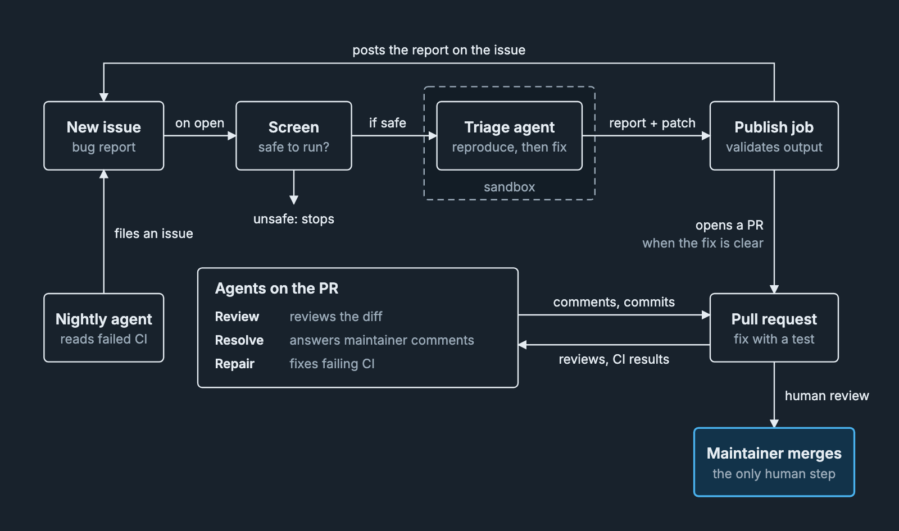
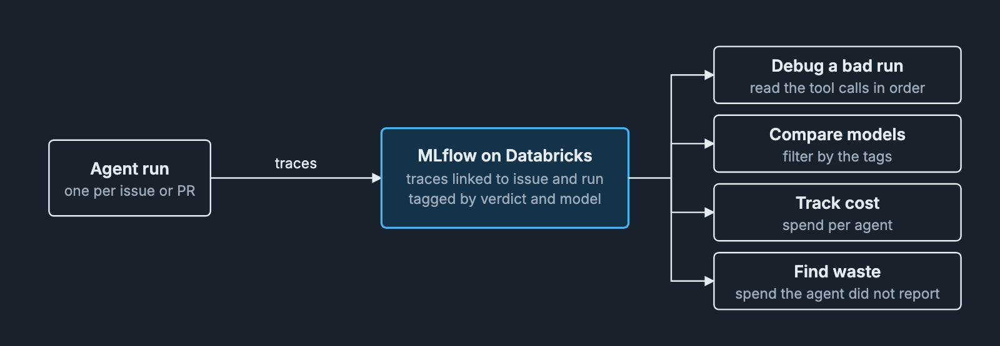
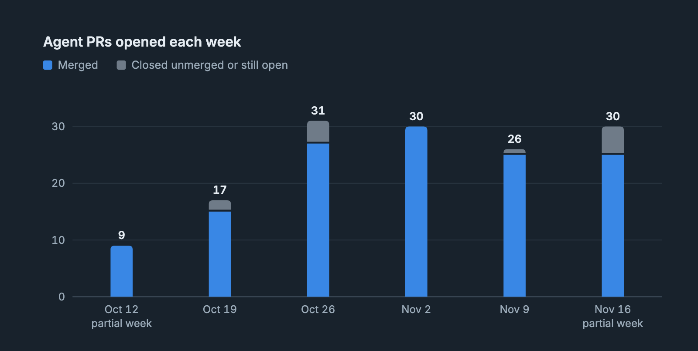
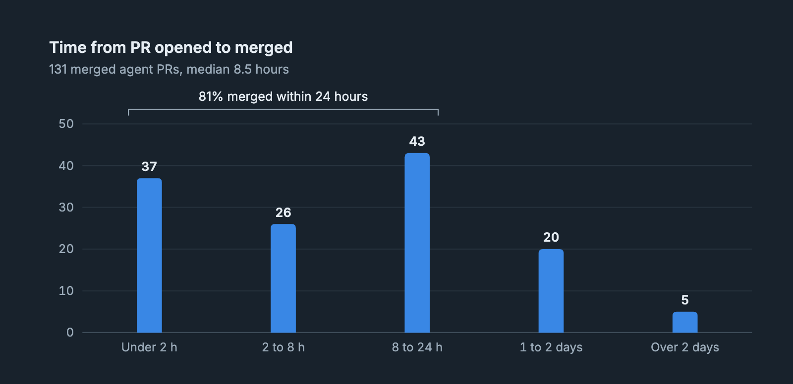
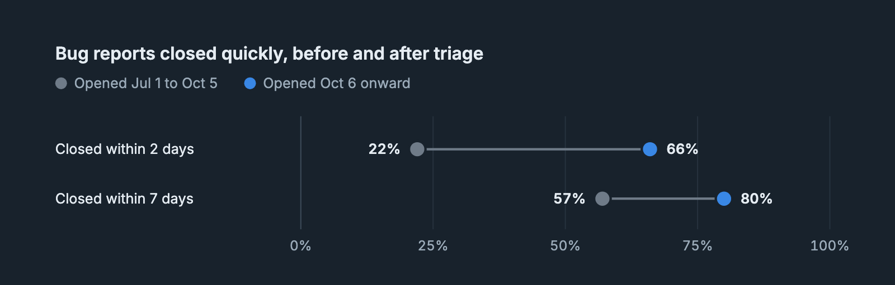

Open a bug report on [mlflow/mlflow](https://github.com/mlflow/mlflow) today and an agent reproduces it, finds the root cause and posts a report, usually within ten minutes. If the fix is clear, a pull request with a regression test follows in the same run. Other agents review that pull request, answer review comments and repair CI. A maintainer merges it.

Together, these agents form the MLflow agent factory. It runs on GitHub Actions, with Databricks behind it for model access and observability. This post covers how it works, how we keep it safe, how we watch the agents, and what the numbers look like after six weeks. All numbers come from the GitHub API as of November 20, 2026.

## Why we built it

MLflow has about 1,500 open issues, and roughly 700 of them are bugs. A maintainer's first hour on a bug usually goes to reproducing it. Before the factory, 57% of bug reports were closed within 7 days and 22% within 2 days.

We also did not want more unreviewed, AI-written pull requests. The goal was agents that work for maintainers: do the reproduction, propose a small fix with a test, and leave the decision to a human.

## What happens when you open an issue

1. **Under 2 minutes:** a comment says an agent is triaging the issue. The median is 1.4 minutes after the issue opens.
2. **About 9 minutes:** the comment is replaced by the report. It has a verdict, expected and actual behavior, steps to reproduce, the root cause with links to the code, and a suggested fix.
3. **Same run:** if the bug reproduced and the fix has no open design question, the agent's fix is opened as a pull request with a regression test.
4. **On the pull request:** AI review runs automatically. When a maintainer leaves a review, an agent addresses each comment and replies. Another agent watches CI and fixes failures.
5. **A maintainer merges.** The median is 8.5 hours after the pull request opened.

## The agents

| Agent   | Runs when                                | Agent does                                            | Workflow publishes                                  |
| ------- | ---------------------------------------- | ----------------------------------------------------- | --------------------------------------------------- |
| Triage  | An issue is opened, or a maintainer asks | Reproduces, finds root cause, optionally writes a fix | Label, comment, optional pull request               |
| Review  | A review is requested on a pull request  | Reviews the diff                                      | Review comments                                     |
| Resolve | A maintainer reviews an agent PR         | Addresses each comment, writes a patch                | Commit, replies, resolved threads                   |
| Repair  | CI fails on a PR that opted in           | Diagnoses the failure                                 | Rerun, merge base, or fix commit                    |
| Nightly | Daily                                    | Groups CI failures by root cause, checks upstream     | One issue per new cause, which Triage then picks up |

A few things worth knowing:

- **Small definitions:** each agent is a short instruction file plus a schema for its output.
- **Nightly feeds Triage:** a failure found overnight can have a pull request before anyone is at work.

## Security: the agent cannot write anything

Issue text is written by anyone, and an agent that reads it has a shell. Prompt injection is the obvious risk, so the design assumes the agent can be talked into anything.

- **Screen before running.** Hidden text is stripped from the issue, a separate model judges whether the issue is safe to hand to an unattended agent, and each author is rate limited.
- **Sandbox with no write credentials.** The agent runs in an OS-level sandbox with a network allowlist and a read-only token. Model calls leave through a proxy that holds the real model token and forwards them to [Unity Gateway](https://www.databricks.com/product/artificial-intelligence/unity-gateway) on Databricks.
- **The agent proposes, the workflow publishes.** The agent's only output is a structured report and an optional patch. A separate job validates both, and it is the only job that can comment or push. Patches may touch source, tests and docs. They may not touch CI, dependencies or the agent's own instructions.
- **Bounded runs.** Each run has a cost cap and a time limit. There is a kill switch, and a dry-run mode for testing changes.
- **A maintainer merges every change.**

A successful injection can change what the agent writes. It cannot push, comment, or reach a host outside the allowlist, and whatever it writes still has to pass validation and a human review.

## Monitoring: watching the agents with MLflow on Databricks

An unattended agent that comments on public issues needs the same observability as any production service. We use MLflow on Databricks for it. Traces land in Unity Catalog tables, so we can read one run in the MLflow trace view or query all of them with SQL.

Every run exports a trace over OpenTelemetry. Each trace links to its issue and workflow run, and is tagged with the verdict, the model, the effort and whether a pull request was proposed. We use the traces to:

- **Debug a bad triage.** Open the trace from the issue and read the tool calls in order.
- **Compare models and settings.** Filter traces by verdict, model or effort.
- **Track cost.** A Databricks dashboard built on the traces shows spend per agent.
- **Find waste.** Traces show spend that the agent's own cost estimate leaves out.

## Results

Three numbers first:

- **231 bug reports triaged** since October 6, 216 of them reproduced.
- **131 of 143 agent pull requests merged** since October 15, with 6 closed and 6 still open.
- **Bugs closed within 2 days: 22% before, 66% after.**

The pull requests are small: a median of 49 changed lines across 2 files. Most merge quickly.

Bug reports close faster than they did before triage.

|                      | Jul 1 to Oct 5 | Oct 6 onward |
| -------------------- | -------------- | ------------ |
| Bug reports opened   | 166            | 204          |
| Closed within 2 days | 37 (22%)       | 134 (66%)    |
| Closed within 7 days | 94 (57%)       | 163 (80%)    |
| Median days to close | 4.4            | 0.8          |

The triage agent authored 131 of the 755 pull requests merged since October 15, or 17%.

What the triage agent concluded:

| Verdict                           | Bug reports |
| --------------------------------- | ----------- |
| Reproduced                        | 216         |
| Skipped (sandbox lacks resources) | 10          |
| Already fixed                     | 3           |
| Not reproduced                    | 2           |
| Needs info                        | 1           |

Counts are by verdict label, and one issue carries two.

The other agents:

- **Nightly:** 20 issues filed, all 20 closed as completed, with a median of 5 hours.
- **Review:** 850 pull requests reviewed.
- **Repair:** 139 pull requests opted in.

## What the numbers hide

- **The issue mix changed.** Bug reports went from 67 in September to 170 in October. Filing an issue became the cheapest way to get a fix, so maintainers and regular contributors file more. Of the 231 triaged bug reports, 146 came from members, collaborators or prior contributors, and 85 from first-time reporters. The before and after table compares different populations.
- **94% reproduced is high.** Either the reports are good or the verdict is generous. We have not audited a sample yet.
- **The agent rarely pushes back.** Only 1 issue got "needs info" and 2 got "not reproduced".
- **The backlog is untouched.** About 1,500 issues are still open. Triage only sees new issues.
- **Review is light for most agent PRs.** 112 of 131 merged without a human review comment or change request. They are small, but that is still a lot of trust.
- **Six pull requests were rejected.** Maintainers closed them without merging.

## What's next

- **Merging without a human**, for the pull requests that qualify. Today a maintainer merges every change, and that merge is one of the safeguards above, so this needs a clear rule for which pull requests qualify and what replaces the human check.
- **A backlog pass**, modelled on the [Next.js close queue](https://nextjs.org/blog/how-we-closed-1500-github-issues).
- **Measuring quality:** revert and reopen rates, and sampled audits of verdicts.

## Try it

Everything is in the [public repository](https://github.com/mlflow/mlflow): the workflows, the agent instructions and the sandbox configuration. If you open an issue, you will meet the factory within a couple of minutes.
